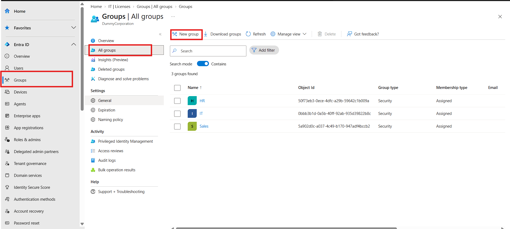
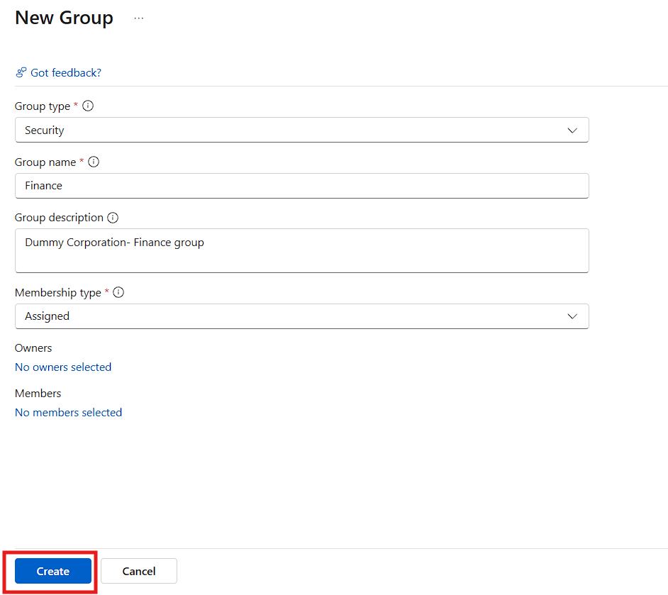
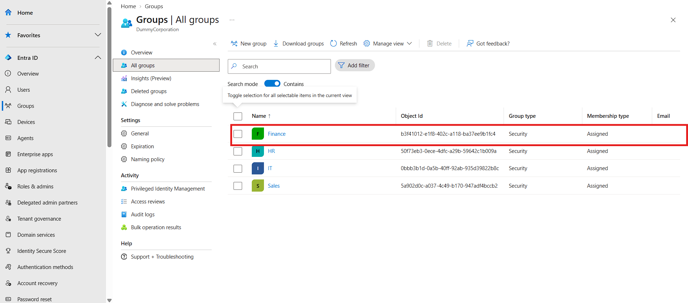
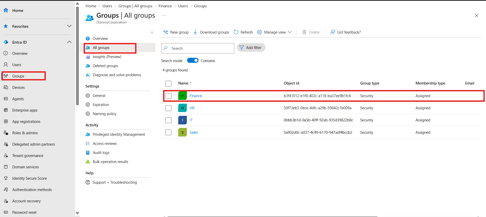
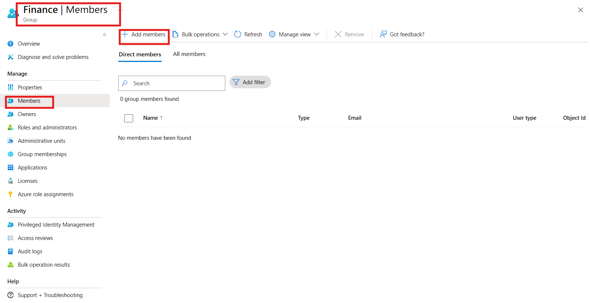
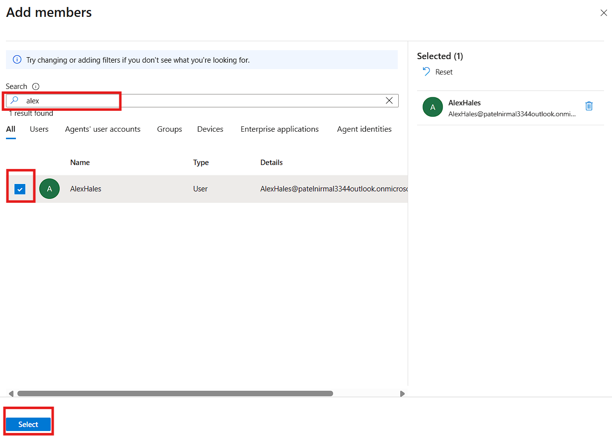

# how to create a group in Entra ID
- Step 1: Go to groups tab in left navigation menu and then click all groups and then new group as shown in image below

- Step 2: Fill in all the details of group make sure Security group is selected as shown in the image below and then click create
  
- step 3: Now check if group is created or not by clicking all groups in this example i have created finance group as you can see in image below
  

**Now we have created Finance group successfully**
# Adding user to group
 
- Step 1: Go to Finance group and click add member 
  
- Step 2: search for user and check the appropriate user then click select
   
 
