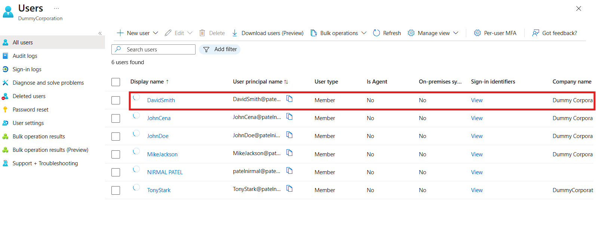

# Creating a user in Entra ID
# Business scenerio :
Now imagine that Dummy corporation has need of web developer and they decided to hire david now to give access to resources we need to create a account for david.

# Objective 
Create a new employee account in Microsoft Entra ID and configure the employee's basic profile information as part of the onboarding process.
# Environment 
- Platform: Microsoft Entra ID
- Tenant: Dummy Corporation
- Licence: Microsoft Entra ID Free
- Tool: Microsoft Entra Admin Center
# **Implementation:**
-Step 1 – Navigate to Users
To create a new user, navigate to: Microsoft Entra Admin Center → Users → All users → New user → Create new user.
 
- Step 2 – Enter Employee Details : Enter the employee's details. In this scenario, the new employee is David Smith.
   
- Step 3 – Configure User Properties: Add the relevant employee information, such as department and job title.
  

- Step 4 – Review and Create : Review the information entered and select Review + Create to create the account.
- Now we can see DavidSmith in our users list
   
- Group membership and resource access will be configured in a later lab.

# **Result:**
Successfully created a new user account for David Smith in the Dummy Corporation Microsoft Entra ID tenant.
The account was created as the first step in the employee onboarding process.
# **skills developed:**
- Navigating the Microsoft Entra Admin Center.
- Creating user accounts.
- Configuring employee profile properties.
- Understanding the user onboarding process.

  

 

