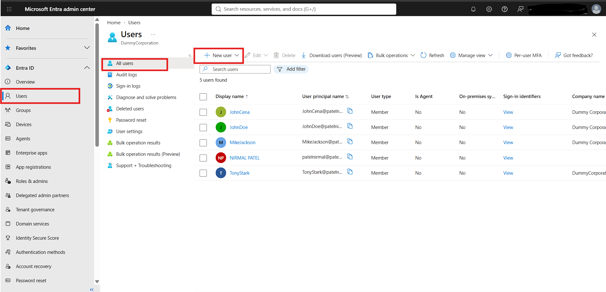
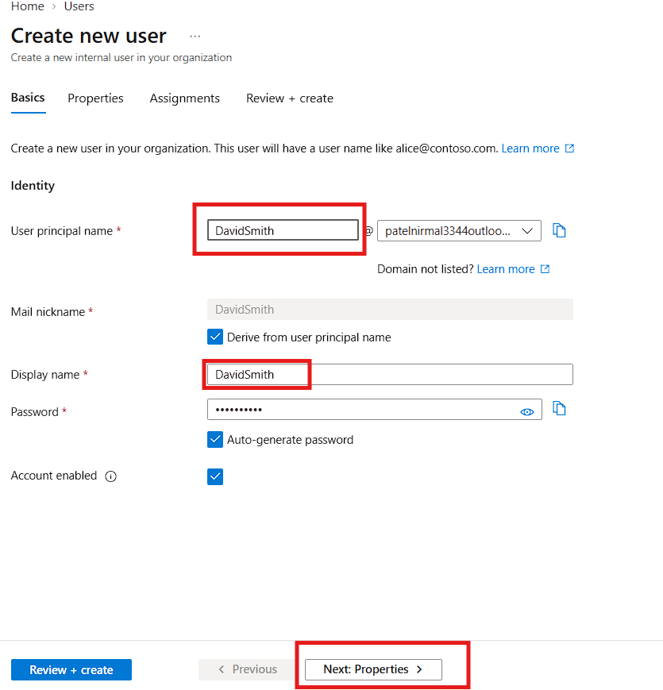
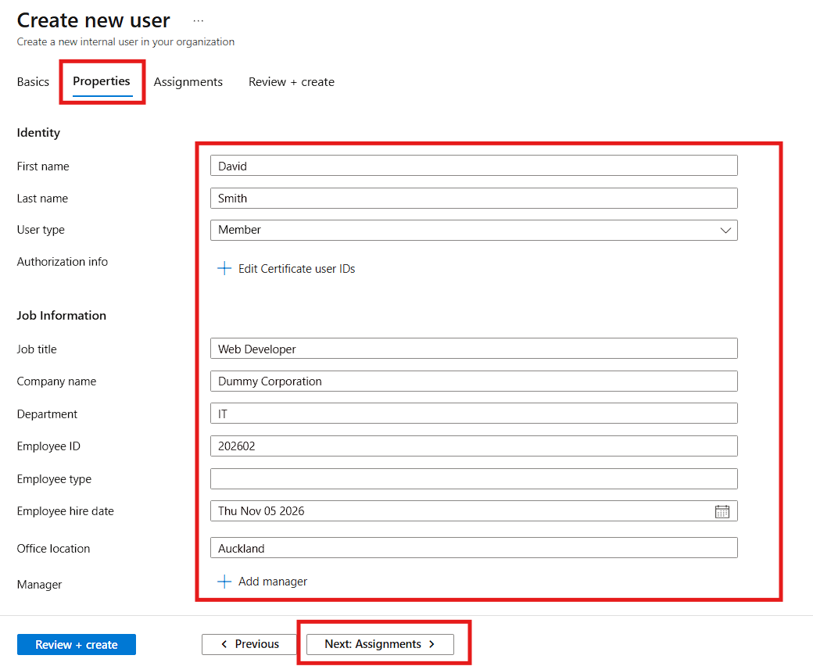

Now imagine that Dummy corporation has need of web developer and they decided to hire david now to give access to resources we need to create a account for david.
Objective: To Onboard david to give access of company resources we need to create an account for david
Implementation: 
- To create a user go to https://entra.microsoft.com/ > Users > All users > New user > create new user
 

- Add details of employee in our case is david smith
   
- Add properties of David smith
  

- Once you fill all the properties click Review and create. We will assign group later on.
Result:
Created a user successfully
skills developed:
Learned how to onboard a new user 
  

 

